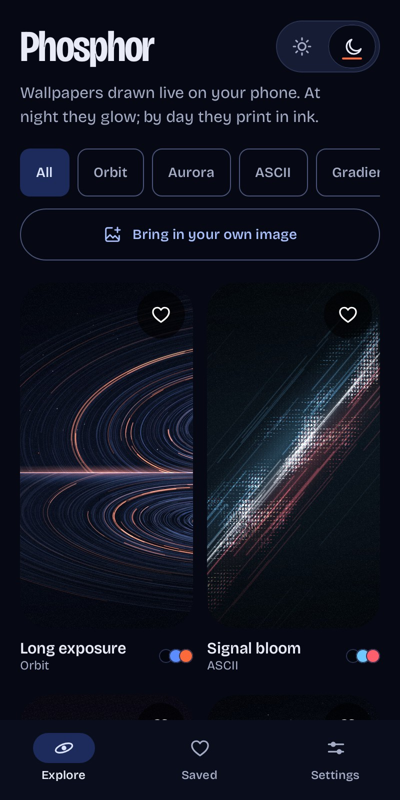
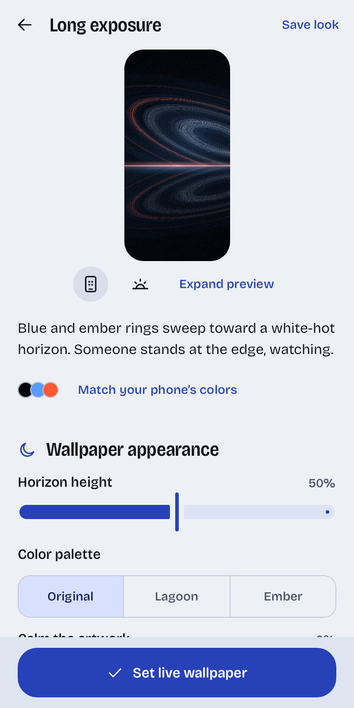
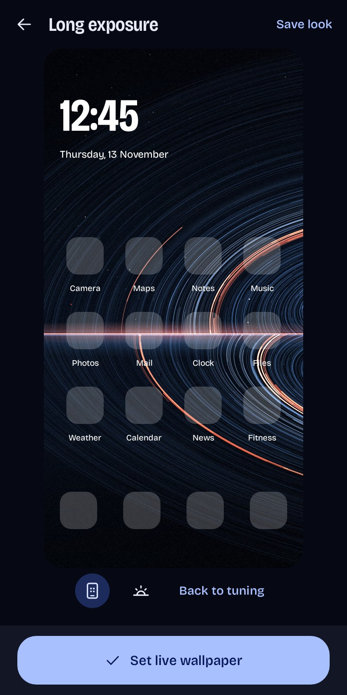

# Phosphor

An offline live wallpaper studio for Android. Choose from 17 animated designs, or give one of your photos a gentle drift.

| Browse the collection | Tune the wallpaper | Preview behind icons |
| :---: | :---: | :---: |
| [](docs/store/screenshots/07-gallery-night.jpg) | [](docs/screenshots/editor.jpg) | [](docs/store/screenshots/09-editor-home-night.jpg) |

Open **Explore**, tap a design, then choose **Set live wallpaper**. Android’s picker lets you choose where to apply it. **Save look** keeps your palette and tuning for later or for a rotation. **Save a still image** exports a 1080 × 2400 PNG.

## Run it

Connect an **Android 8.1+** device with live wallpaper support. Build with **JDK 17**, **Android SDK 36**, and **Build Tools 35.0.0**.

```sh
./gradlew installDebug
```

On Windows, use `.\gradlew.bat installDebug`. [Setup and troubleshooting](docs/GETTING_STARTED.md) · [Debug APKs from main](docs/RELEASING.md#debug-apks-from-main)

[User guide](docs/USER_GUIDE.md) · [Architecture](docs/ARCHITECTURE.md) · [Testing](docs/TESTING.md) · [All docs](docs/README.md) · [Contributing](CONTRIBUTING.md)

Phosphor works without an account, ads, analytics, or network permission. Imported photos stay in private app storage.

Made by [sush.dev](https://sush.dev?utm_source=phosphor). [Code and original artwork (MIT)](LICENSE) · [Bricolage Grotesque (OFL)](app/src/main/assets/licenses/bricolage-grotesque-OFL.txt). Reference images in `ref-img/` and personal imports are outside the MIT grant.
