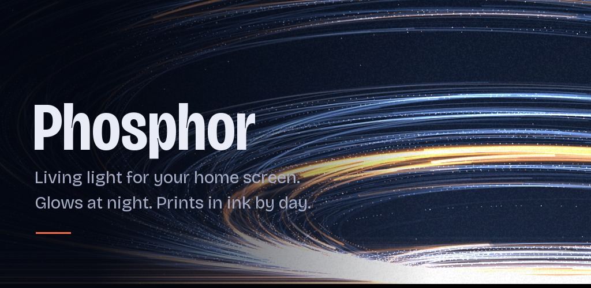

# Phosphor

Living color for Android. An offline, open-source live wallpaper app [made by sush.dev](https://sush.dev?utm_source=phosphor).



Phosphor draws its wallpapers on your phone: long-exposure orbits, aurora curtains, digital rain, beams of characters, gradients, glass, filaments, and etched textures. Each procedural preset has a night treatment of emitted light on a deep, tinted ground and a day treatment of luminous color on pale paper, both built from the same color harmony. Auto follows your phone's dark theme.

## What you can do

- Choose from **16 procedural presets across seven collections**, or import your own image for gentle drift, ripples, and floating light.
- Tune speed, intensity, frame rate, and how far the artwork fades into its background. Check the result in a live preview with an optional home-screen overlay.
- Interact with taps, drags, and launcher swipes. Responses settle even when ambient speed is zero; launcher support varies.
- Use day, night, or automatic appearance, wake reveals, lock/unlock animation, or still mode.
- Browse previews shown at your phone's own screen proportions, and export a **1080 × 2400 PNG** in the selected treatment. Wallpapers, artwork previews, and exports have no branding.
- Keep rendering bounded: animation stops while hidden or screen-off, the visible lock screen is capped at 15 fps, and battery policies reduce motion at low charge.

No account, ads, analytics, network permission, broad photo-library permission, or cloud backup. Images are imported through Android's document picker and copied to private app storage. The optional creator link opens in your browser.

## Try it

Phosphor requires **Android 8.1 (API 27) or newer** and a device that supports live wallpapers. It targets API 36. Build and install a debug APK using the [getting started guide](docs/GETTING_STARTED.md), then follow the [user guide](docs/USER_GUIDE.md) to apply a wallpaper.

Pixel and Samsung One UI are intended targets. Wallpaper destinations, palette choices, and lock-screen behavior depend on the OS and launcher. See [Android compatibility](docs/ANDROID_COMPATIBILITY.md) for supported behavior and device checks; implementation support does not mean every device has been tested.

## Build from source

Use **JDK 17**, Android SDK **Platform 36**, and **Build Tools 35.0.0**. The checked-in wrapper supplies Gradle 8.13. Set `JAVA_HOME` to your JDK and `ANDROID_HOME` to your SDK, or configure the SDK in an untracked `local.properties`.

From the repository root on macOS/Linux:

```sh
./gradlew testDebugUnitTest lintDebug assembleDebug
```

On Windows PowerShell:

```powershell
.\gradlew.bat testDebugUnitTest lintDebug assembleDebug
```

The APK is written to `app/build/outputs/apk/debug/app-debug.apk`. The first build needs internet access to download Gradle and dependencies; the installed app works offline. See [setup and troubleshooting](docs/GETTING_STARTED.md) for SDK installation, Android Studio, and device installation.

## Documentation

| If you want to… | Read |
| --- | --- |
| Build, run, or fix a local setup | [Getting started](docs/GETTING_STARTED.md) |
| Apply, customize, import, or export a wallpaper | [User guide](docs/USER_GUIDE.md) |
| Find your way around the code | [Architecture](docs/ARCHITECTURE.md) |
| Run tests or generate previews and store assets | [Testing](docs/TESTING.md) |
| Submit a fix, new preset, or bug report | [Contributing](CONTRIBUTING.md) |
| Prepare a version, sign a build, or tag a release | [Releasing](docs/RELEASING.md) |

The [documentation index](docs/README.md) also links the design system, platform checklist, and historical validation results.

## Artwork and licensing

The source code and original procedural artwork are [MIT licensed](LICENSE). Bricolage Grotesque is bundled under the [SIL Open Font License 1.1](app/src/main/assets/licenses/bricolage-grotesque-OFL.txt).

`ref-img/` contains tracked inspiration images, but is outside Android's source sets and is not packaged in the app. Those files have no accompanying redistribution licenses; the repository's MIT license does not grant rights to them or to personal imports. Do not use them in distributed app or store assets without establishing permission. Contributed third-party assets need provenance and a compatible license.
