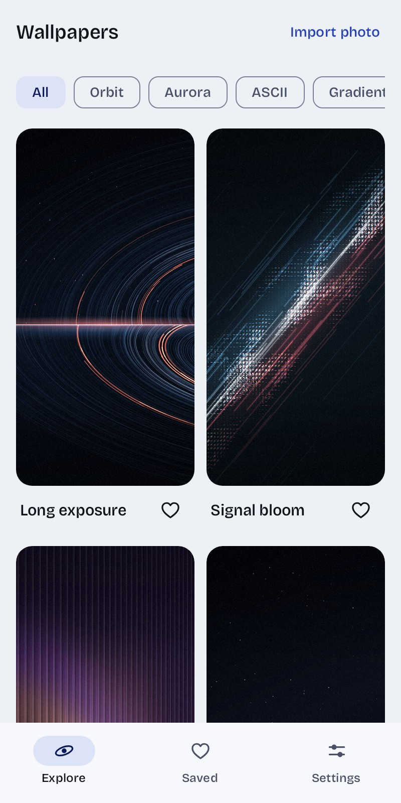
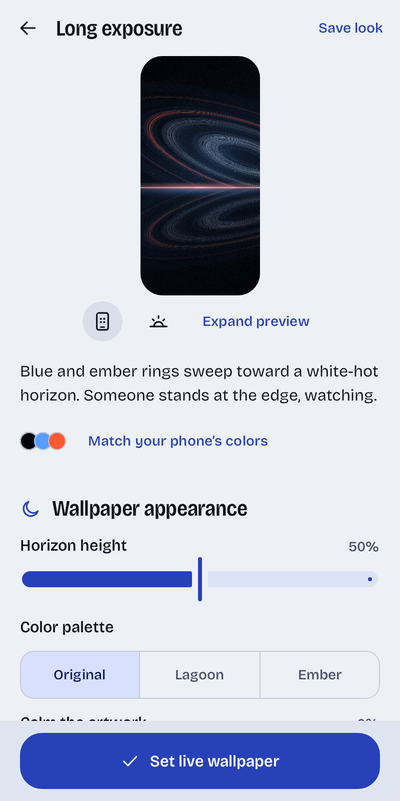

# Using Phosphor

## Apply a wallpaper

| Explore | Editor | Android picker |
| --- | --- | --- |
| Tap a collection, then a wallpaper. | Check the artwork behind sample icons, then tap **Set live wallpaper**. | Choose where to apply it and confirm. |

 

Edits stay in your draft until you apply them. If Android leaves the result unclear, tap **Save wallpaper settings** only after choosing Phosphor in the picker. Home and lock screens share the applied design.

## Keep a look or a photo

| To… | Use… |
| --- | --- |
| Bookmark a wallpaper | The heart beside its title in **Explore**. |
| Keep a tuned version | **Save look** in the editor. Reopen it from **Saved** to update it or **Save a copy**. |
| Rotate saved looks | Save at least two looks. In **Saved → Rotation**, choose **Daily** to cycle at midnight or **Day and evening** to set two start times. The next look appears when the wallpaper is visible. |
| Frame a photo | **Explore → Import photo**. Choose a JPEG, PNG, or WebP, then move the target in **Photo framing**. Save the look to keep its crop. |
| Export the current look | **Save a still image**. Pick a location for the 1080 × 2400 PNG. |

Phosphor keeps a private copy of each imported photo. Clearing app storage or uninstalling removes these copies and saved looks.

## Tune a scene

Use the scene slider to change the composition, such as the ring angle in Ringfall or the rib spacing in Fluted glass. In **Textures → Pixel weave**, adjust **Pixel spacing** to make the curved bands of flickering squares finer or coarser.

Under **Color palette**, tap **Background**, **First accent**, or **Second accent** to edit the current colors. Choose a color with the RGB sliders or enter a six-digit hex value, then tap **Use color**. Switch between **Original**, **Lagoon**, **Ember**, and **Custom** to compare. Use **Save look** to keep a color combination.

Imported photos have controls for **Shadows**, **Highlights**, and **Floating lights**. **Original** shows the photo in its natural colors.

For **ASCII → Echo trace**, enable **Motion → React to music** and grant audio permission. Play music to see bass on the left and treble on the right. Android supplies playback frequencies. Silence, gallery thumbnails, and still exports use the ambient design.

## Motion and battery

| For this effect | Adjust |
| --- | --- |
| Quieter artwork behind icons | **Calm the artwork** to darken it. |
| Slower or subtler movement | Lower **Speed** or **Intensity**. **Still mode** freezes the scene. |
| Depth as you swipe or tilt | Enable **Home-screen parallax**. Add **Tilt parallax** on phones with an accelerometer. Both need motion enabled. |
| A reveal when the screen wakes | Enable **Light up on wake**. Tap replay to preview it. **Lock and unlock animation** controls the lock transition. |
| Smoother motion or fewer frames | Choose **15**, **30**, or **60 fps** under **Frame rate**. |

Battery Saver and the visible lock screen cap animation at 15 fps. With **Save battery when low**, an unplugged phone slows at 20% and holds still at 5%. Animation stops when hidden or screen-off.

## Check for updates

Open **Settings** and scroll to the installed version. When a newer version is available, **View release and download APK** opens its GitHub release page. **Check again** retries the check after an offline or unavailable response.

## Change colors

**Settings → App appearance** changes the app theme. **Use your phone’s colors** follows the Android 12+ system palette. Use the editor’s **Color palette** to recolor a wallpaper.

For launcher colors, open **Wallpaper & style** on Pixel or **Wallpaper and style → Color palette** on Samsung. If your launcher only offers colors for photos, try applying an exported still, choosing its palette, then reapplying Phosphor.

[Android compatibility](ANDROID_COMPATIBILITY.md) · [Build and install](GETTING_STARTED.md) · [Documentation index](README.md)
